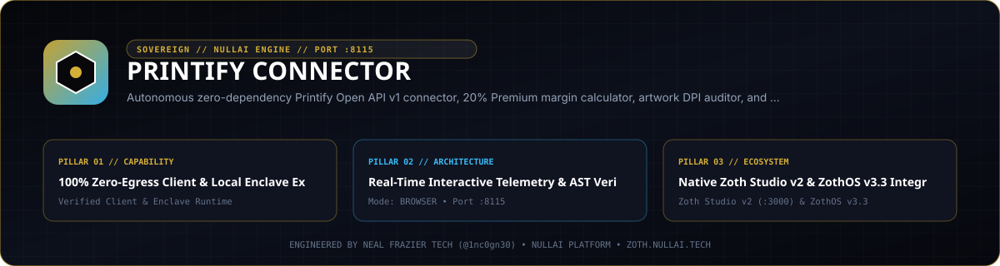

<p align="center">
  
</p>

# Printify Connector

Zero-dependency Python 3.10+ toolkit for Printify print-on-demand work: a bundled blueprint and print-provider reference catalog, a multi-channel margin calculator (Etsy, Shopify, direct checkout) with the 20% Printify Premium discount, a 300 DPI artwork auditor, a Printify v1 product-payload builder, a loopback HTTP workstation, and a 6-tool MCP stdio server.

- Zoth Studio v2 dossier: https://zoth.nullai.tech/tools/printify-connector
- Local workstation: `http://127.0.0.1:8115`
- Runtime dependencies: none (Python standard library only)
- License: MIT

## What It Does

- **Catalog lookup**: 7 bundled blueprints (tee, crewneck, hoodie, mug, canvas wrap, tumbler, notebook) with standard and Premium base costs and print-area pixel sizes, plus 6 print providers with location, rating, turnaround and shipping rates.
- **Margin engine**: for a blueprint and retail price, computes base cost, optional Premium discount, shipping, channel fees (Etsy 6.5% transaction + 3% payment + $0.25 + $0.20 listing; Shopify and direct checkout 2.9% + $0.30), net profit, margin %, break-even price, and recommended 30/50/65% margin price tiers.
- **Artwork auditor**: checks pixel width/height, aspect ratio and effective DPI against a blueprint print area before upload.
- **Payload builder**: generates a Printify v1 product-creation JSON body (variants priced in cents, print areas, tags).
- **Shop info**: with `PRINTIFY_API_TOKEN` set, calls `GET /v1/shops.json`. Without a token it returns `api_connected: false` and an explanatory error; it never fabricates shop data.

The catalog, margin, audit and payload tools run entirely offline on the bundled reference data. Prices in the bundled catalog are reference values; confirm current costs in your Printify dashboard before publishing.

## How It Works

```text
src/printify_connector/
├── catalog.py          # Bundled blueprint and print-provider reference data
├── client.py           # Stdlib Printify v1 client (live only when PRINTIFY_API_TOKEN is set) + payload builder
├── margin_engine.py    # COGS, Premium discount, channel fees, break-even, price tiers
├── artwork_auditor.py  # Effective DPI, aspect ratio, print-area fit
├── mcp_server.py       # MCP stdio server (JSON-RPC 2.0: initialize, tools/list, tools/call)
├── server.py           # Loopback HTTP API + static workstation from public/
└── cli.py              # `printify-connector` entry point
bin/printify-connector       # Runs the CLI from a checkout without installing
bin/printify-connector-tui   # Terminal summary + benchmark of the real margin/audit engine
public/                      # Browser workstation (margin calculator, DPI auditor, payload builder)
```

The HTTP server only accepts browser `POST` requests from `localhost` / `127.0.0.1` / `[::1]` origins (CSRF guard) and binds to `127.0.0.1` unless you pass `--host` or set `ZOTH_BIND_HOST` to an IP literal.

## Install

```bash
git clone https://github.com/1nc0gn30/printify-connector.git
cd printify-connector
python3 -m pip install -e .

# Start the workstation on http://127.0.0.1:8115
python3 server.py --host 127.0.0.1 --port 8115
# or, after installing:
printify-connector serve --port 8115
# or, without installing:
./bin/printify-connector serve
```

`npm start` runs the same `python3 server.py --host 127.0.0.1 --port 8115`.

## Configuration

| Variable | Required | Purpose |
| :--- | :--- | :--- |
| `PRINTIFY_API_TOKEN` | No | Personal access token from https://printify.com/app/account/api. Enables live `GET /v1/shops.json` and live catalog calls. |
| `PRINTIFY_SHOP_ID` | No | Shop ID reported in offline shop-info responses. |
| `ZOTH_BIND_HOST` | No | IP literal to bind instead of `127.0.0.1` (e.g. `0.0.0.0`). |
| `PORT` | No | Backend port used by the optional Electron shell (`electron/main.cjs`, default 8115). |

## CLI Reference

```bash
printify-connector --help
printify-connector --version
printify-connector --json                 # status as JSON (same as --status --json)
printify-connector status [--json] [--port 8115]
printify-connector serve [--host 127.0.0.1] [--port 8115]
printify-connector mcp                    # MCP stdio server
printify-connector blueprints [--category Apparel|Drinkware|Home|Stationery]
printify-connector providers [--country US|UK|DE]
printify-connector margins --blueprint bella_canvas_3001 --price 29.99 --shipping 4.99 [--premium]
printify-connector audit --blueprint bella_canvas_3001 --width 4500 --height 5400 [--name design.png]

printify-connector-tui [--json] [--price 28] [--iterations 50]
```

`status` probes `http://<host>:<port>/health` and reports `online` or `standby`, catalog counts, and whether `PRINTIFY_API_TOKEN` is set.

## MCP Reference

```json
{
  "mcpServers": {
    "printify-connector": { "command": "printify-connector", "args": ["mcp"] }
  }
}
```

| Tool | Description |
| :--- | :--- |
| `printify_search_blueprints` | Search the bundled catalog by keyword or category |
| `printify_get_print_providers` | Providers for a blueprint (`source` field says live API vs offline reference) |
| `printify_calculate_margins` | COGS, Premium discount, channel fees, break-even and net margin |
| `printify_audit_artwork` | Pixel size, aspect ratio and effective DPI check |
| `printify_create_product_payload` | Printify v1 product-creation JSON body |
| `printify_get_shop_info` | Live shop list, or `api_connected: false` with a configuration hint |

## REST Reference

| Method | Endpoint | Description |
| :--- | :--- | :--- |
| `GET` | `/health`, `/api/health` | Status, version, bound port, `apiConfigured` |
| `GET` | `/api/stats` | Catalog counts and supported channels |
| `GET` | `/api/blueprints[?category=]` | Blueprint list |
| `GET` | `/api/blueprints/<id>` | Single blueprint (404 if unknown) |
| `GET` | `/api/providers[?country=]` | Provider list |
| `GET` | `/api/providers/<id>` | Single provider (404 if unknown) |
| `POST` | `/api/margins` | `{blueprintId, retailPrice, shippingCharged, hasPrintifyPremium, targetMarginPct}` |
| `POST` | `/api/audit` | `{blueprintId, widthPx, heightPx, fileName, fileSizeBytes}` |
| `POST` | `/api/shipping` | Shipping-rate lookup for a blueprint and destination |
| `POST` | `/api/create-payload` | Printify product payload from `{blueprintId, printProviderId, title, description, tags, imageUrl}` |

## Port

`127.0.0.1:8115`, matching the `printify-connector` entry in Zoth Studio v2 `tools.json`. The same default is used by `server.py`, the CLI, `package.json` scripts and `electron/main.cjs`. On ZothOS v3.4.0 the `printify-connector` and `printify-connector-tui` commands are installed to `/usr/local/bin/`.

## Testing

```bash
python3 -m pytest -q          # or: npm test
gitleaks dir --no-banner .
```

Tests use an ephemeral port (`port=0`) for the HTTP server and make no external network calls.

## License

MIT. Copyright (c) 2026 [1nc0gn30](https://1nc0gn30.si) and [NullAI](https://nullai.tech). See [LICENSE](LICENSE).

Free and open-source. Optional support: [Buy Us a Coffee (Stripe)](https://buy.stripe.com/3cIfZg27PdKo2D64Ocfw40X).
