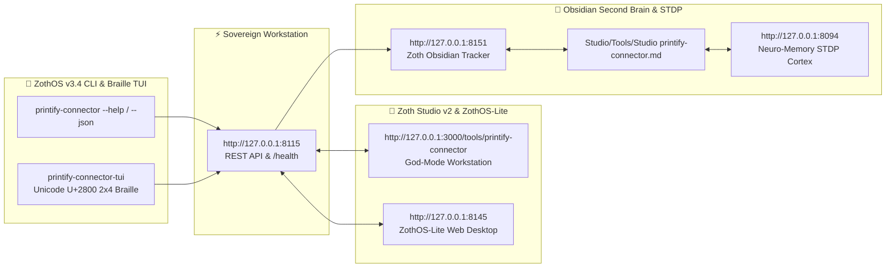

<div align="center">
  
</div>

<br />

# 📦 Printify Connector for Antigravity & Sovereign AI Agents

> ⚡ **Live Web Application**: [https://printify.nullai.tech](https://printify.nullai.tech)  
> 🏛️ **Zoth Studio Workspace**: [https://zoth.nullai.tech/tools/printify-connector](https://zoth.nullai.tech/tools/printify-connector)  
> 🛡️ **Sovereign Status**: 100% Free & Open-Access · Zero Paywalls · 100% Zero-Egress Compatible

[](https://printify.nullai.tech)
[](https://modelcontextprotocol.io)
[](https://python.org)
[](https://nullai.tech)

Autonomous **Printify Open API v1 Connector**, 20% Premium Margin Engine, Artwork DPI Auditor, and Antigravity MCP Suite for **Google Antigravity** AI agents and **Zoth Studio v2 / ZothOS Linux 3.3**. Exposes 6 Model Context Protocol (MCP) tools for catalog search, print provider routing, real-time fee & profit modeling across sales channels, artwork validation, and product payload generation.

---

## 📖 What It Does

- **Printify Open API v1 Integration**: Search blueprints (Bella+Canvas 3001, Gildan 18000, Ceramic Mugs, Posters) and compare verified print providers (Monster Digital, SwiftPOD, District Photo, MyLocker).
- **20% Printify Premium Margin Simulator**: Real-time margin calculator comparing Etsy, Shopify, and Direct Web3 sales channels, factoring in Printify Premium discounts and computing annual break-even order volume.
- **Artwork DPI & Resolution Auditor**: Validates image dimensions and pixel density against exact physical print areas (e.g. 4000x4800 px @ 300 DPI) with zero-upload in-browser verification.
- **Automated JSON Product Payloads**: Formats complete multi-variant product creation payloads for automated submission to Printify's API.
- **100% Free & Open-Access**: Zero paywalls, zero license locks, zero telemetry leaks.

---

## ⚙️ How It Works

1. **Standalone Enclave (`127.0.0.1:8115`)**: Powered by `server.py` serving a dark-glassmorphic cockpit with live `/health`, `/api/stats`, `/api/blueprints`, `/api/providers`, and `/api/margins` endpoints.
2. **Zoth Studio v2 God-Mode Route**: Deeply integrated into the 77-Tool Sovereign Matrix at `/tools/printify-connector`.
3. **ZothOS CLI (`printify-connector`)**: Native binary installed in `/usr/local/bin` and `~/.local/bin` for automated command-line audits and CI/CD pipelines.
4. **Antigravity MCP Bridge**: Standard JSON-RPC 2.0 stdio server providing 6 autonomous tools for AI agents.

---

## ⚡ 6 Model Context Protocol (MCP) Tools

When registered in `~/.gemini/config/mcp_config.json`, Antigravity gains immediate access to:

1. `printify_search_blueprints`: Search catalog blueprints by query or category.
2. `printify_get_print_providers`: List verified print providers for a blueprint.
3. `printify_calculate_margins`: Compute exact COGS, fees, net margins, and break-even pricing.
4. `printify_audit_artwork`: Validate artwork pixel dimensions and DPI against print areas.
5. `printify_create_product_payload`: Generate validated Printify product creation JSON payloads.
6. `printify_get_shop_info`: Retrieve store connection status and channel metadata.

---

## 💻 ZothOS CLI & Server Commands

```bash
# Check status and health
printify-connector --status
printify-connector status

# Output telemetry in JSON format
printify-connector --json

# List available catalog blueprints
printify-connector blueprints --category Apparel

# Calculate profit margins with 20% Premium discount
printify-connector margins --blueprint bella_canvas_3001 --price 28.00 --premium

# Audit artwork resolution and DPI
printify-connector audit --blueprint bella_canvas_3001 --width 4500 --height 5100

# Launch standalone workstation server on port 8115
python3 server.py --port 8115
```

---

## ☕ Support 1nc0gn30 • NullAI & NullAI

Printify Connector is 100% free, open-source, and sovereign software. If this tool brings you value, consider supporting our ongoing development:

- **☕ Buy Us a Coffee (Stripe)**: [buy.stripe.com/3cIfZg27PdKo2D64Ocfw40X](https://buy.stripe.com/3cIfZg27PdKo2D64Ocfw40X)
- **◎ Solana Tip Address**: `GG2eQbVh8ut1BK6j1A2tz7pSySdLpD38BgyEhGcxdXoK`

---

<div align="center">
  <sub>Engineered by <b>1nc0gn30 • NullAI</b> (<a href="https://github.com/1nc0gn30">@1nc0gn30</a>) &bull; <a href="https://nullai.tech">NullAI Platform</a> &bull; <a href="https://zoth.nullai.tech">Zoth Studio v2</a></sub>
</div>

---

## 🏛️ ZothOS v3.4, Zoth Studio v2 & Obsidian Second Brain Ecosystem



### Cross-Surface Integration Matrix

| Surface | Endpoint / Binary | Capabilities |
| :--- | :--- | :--- |
| **Standalone Workstation** | `http://127.0.0.1:8115` | 100% Free & Open-Access Web Deck, live `/health` & REST telemetry |
| **Zoth Studio v2 Route** | `http://127.0.0.1:3000/tools/printify-connector` | Interactive God-Mode component inside Zoth Studio (`https://zoth.nullai.tech`) |
| **ZothOS v3.4 CLI & TUI** | `printify-connector` / `printify-connector-tui` | Global binary in `/usr/local/bin/` with Unicode `U+2800` Braille TUI & `--json` output |
| **ZothOS-Lite Web Desktop** | `http://127.0.0.1:8145` | Browser-native KDE-style window manager & terminal launcher |
| **Zoth Obsidian Tracker** | `http://127.0.0.1:8151` | Interactive Obsidian Second Brain vault explorer (`~/Documents/Obsidian Vault/Studio/Tools/Studio printify-connector.md`) |
| **Neuro-Memory STDP Cortex** | `http://127.0.0.1:8094` | 3-Factor STDP synaptic memory daemon & 21-tool MCP server |

```bash
# Inspect CLI & Unicode U+2800 Braille TUI on ZothOS v3.4
printify-connector --help
printify-connector-tui --status
printify-connector-tui --json

# Verify Second Brain Vault & 12-Step Verification Gallery on :8151
zoth-obsidian-tracker --verify
```

